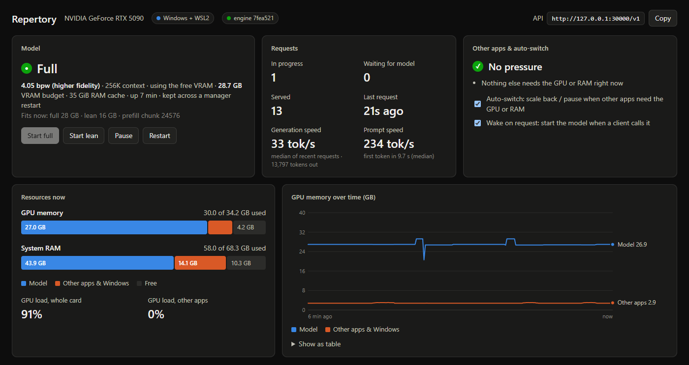
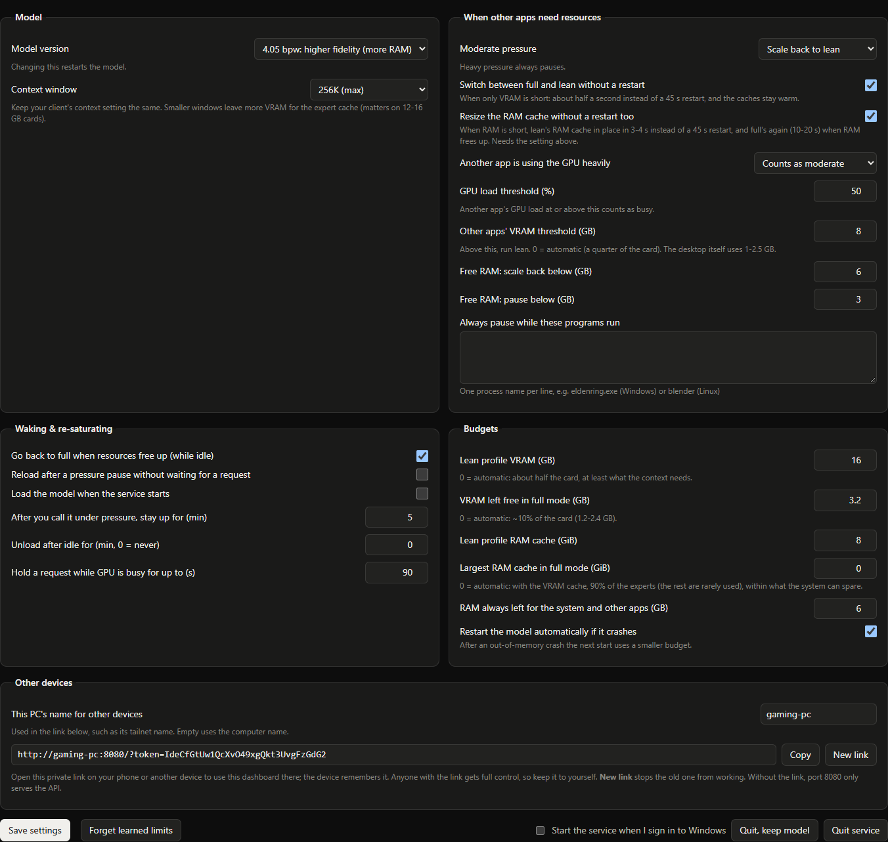
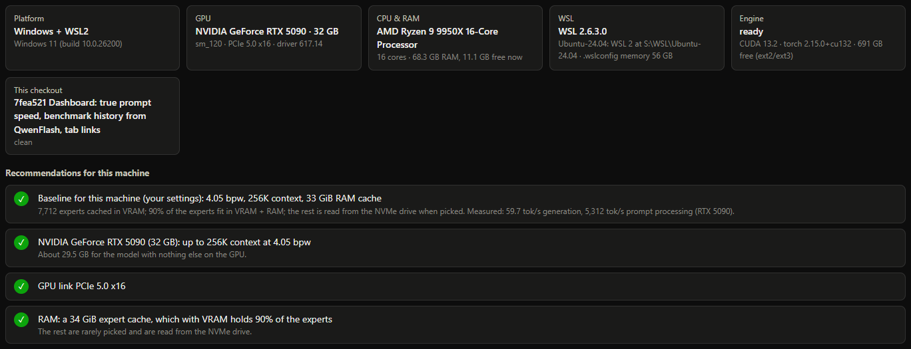
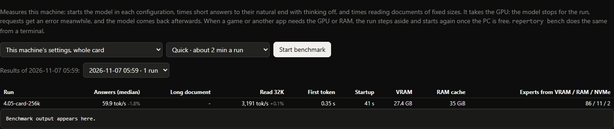
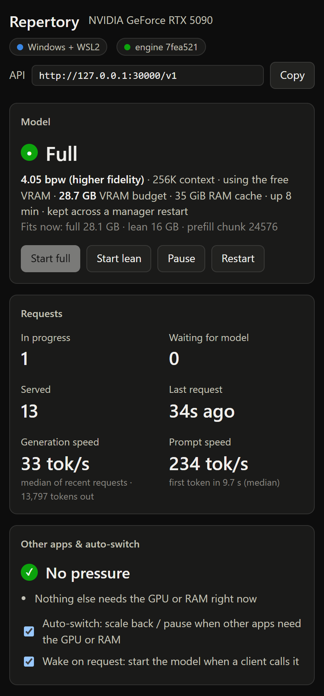

# Repertory

Local AI that shares your GPU. Run big models locally and keep your PC usable.

Repertory runs a large local model as a service on a machine that is also used for other things. It started as a way
to scale the model's resources up and down on my cloud gaming machine: when a game needs the GPU or RAM, the model
scales itself back or pauses, and when the game closes, the model takes the resources back.

Today it serves Qwen3.8-Flash-Next, a 125B mixture-of-experts model, at up to 256K context on cards from 8 to 48 GB.
The experts that don't fit in VRAM are kept in RAM and on the SSD. Clients use an OpenAI-compatible API at
`http://127.0.0.1:30000/v1`. GLM-5.3-Flash (320B: 125 GB at 3.05 bpw, 85 GB at 2.05) is in the catalog too; a quant
is offered once it passes curation ([engines and models](docs/engines.md)).



## Quick start

You need an NVIDIA GPU (RTX 20 series or newer, 12 GB or more) with driver 595 or newer, 32 GB of RAM (16 GB on
Linux), a fast NVMe SSD with about 170 GB free, and Git and Python 3. On Windows, tick *Add python.exe to PATH* when
installing Python. On Linux, setup automates Ubuntu 22.04+ and Debian 12+.

Windows:

```powershell
git clone https://github.com/eltorr/llm-repertory.git
cd llm-repertory
.\Repertory.cmd
```

Linux:

```bash
git clone https://github.com/eltorr/llm-repertory.git
cd llm-repertory
./repertory.sh open
```

The dashboard opens at http://127.0.0.1:30000. In its Setup tab, click **Apply baseline**, then run the steps from
top to bottom; each one can be run again safely. When the model is downloaded, point a client at the API. The first
request loads the model, which takes about a minute.

## Using it

### Connect a client

Any OpenAI-compatible client works: base URL `http://127.0.0.1:30000/v1`, a model from `/v1/models`, any API key.
Naming another installed model switches to it ([API](docs/api.md#models)); `qwen3.8-flash-next` means the Qwen
quant that is loaded, or the largest one installed.

```bash
curl http://127.0.0.1:30000/v1/responses -H "Content-Type: application/json" \
  -d '{"model": "qwen3.8-flash-next", "input": "Explain a heat pump in two sentences."}'
```

The Responses API is the main one. Chat Completions works too, with the same streaming, tools and reasoning levels.
Prompts that repeat earlier ones, as an agent's growing conversation does, are served from the prompt cache. See
[API](docs/api.md).

### When a game starts

The manager watches the GPU and RAM. When another app needs them, it moves the model to a lean profile (16 GB of
VRAM, an 8 GiB RAM cache) in about half a second without a restart, or pauses it under heavy pressure. When the app
closes, the model goes back to full. Thresholds, the lean budget and programs that should always pause the model
are in the Settings tab; the Start full, Start lean and Pause buttons switch by hand.

### Other devices

Set a network port in Settings to reach the API from other machines, for example over a tailnet. On that port the
API is open, and the dashboard needs the private link from Settings, Other devices. See
[other machines](docs/manager.md#other-machines) and [security](docs/manager.md#security).

### Benchmarks

The Benchmark tab (or `repertory bench`) starts the model in each configuration and measures generation and prompt
speed on this PC. A run steps aside while a game needs the GPU and resumes afterwards. See
[benchmarks](docs/manager.md#benchmarks).

### Updating

Run `git pull`. The Setup tab then shows which steps to run again: usually the engine, and the GPU kernels when the
engine's code changed.

## How it's built

| Part | Folder | What it does |
|---|---|---|
| Manager | [repertory/](repertory) | The service on port 30000: the API front door, the dashboard, setup, benchmarks, and the model's lifecycle (full, lean, paused, live resize) |
| Model server | [engines/exl3_offload/](engines/exl3_offload) | Runs the model behind the manager: its chat format and tool calls (Qwen3.8, GLM-5.3), memory guards, sizing, verified downloads |
| ExLlamaV3 | [exllamav3/](exllamav3) | turboderp's inference library: the model code and the EXL3 quantized kernels |
| Offload engine | [glm53-flash-offload/](glm53-flash-offload) | sybil-solutions' expert tiers: the hottest experts in VRAM, more in RAM, the rest read from NVMe; the OpenAI APIs on one pipeline |
| Catalog | [catalog/](catalog) | The models and engines, each pinned to one upload, with how to build, prepare and serve them; setup, the dashboard and sizing read it |
| Setup | [setup/](setup) | The install steps for WSL2 and Linux |

On Windows the engine runs inside WSL2, and the manager runs on Windows and starts it there. ExLlamaV3 supports
many more models; the offload engine runs Qwen3.8-Flash-Next and GLM-5.3-Flash. See
[engines and models](docs/engines.md).

A catalog entry is offered once it passes curation (`repertory curate`): a compatibility check that needs no GPU,
and a regression check on the GPU that replays its recorded answers token by token (each position's likeliest
tokens must stay close to the recorded ones, and decode must pick them) at the recorded speed. See
[the catalog](docs/catalog.md).

## The dashboard

**Settings.** What happens when other apps need resources, the lean and full budgets, and the private link for
other devices.



**Setup.** This PC's hardware and the preset the manager recommends for it.



**Benchmark.** Runs and their results.



**On a phone.** The same dashboard, through the private link.



## Presets

The manager starts from a preset for the card and the RAM; run `./repertory.sh plan` to see yours. Cells say what
the preset is and whether it was measured. The figures are for Linux; Windows keeps about 8 GB more RAM for itself.

<!-- presets:begin -->
| Card (VRAM) | 16 GB RAM | 32 GB RAM | 64 GB RAM | 128 GB RAM |
|---|---|---|---|---|
| **8 GB, no display** | **3.05** · 16K, no staging<br>4 GiB RAM cache, 10% in memory<br>not tested yet | **3.05** · 16K, no staging<br>15 GiB RAM cache, 36% in memory<br>not tested yet | **3.05** · 16K, no staging<br>38 GiB RAM cache, 91% in memory<br>measured 26.4 tok/s (RTX 5090 capped to 8 GB) | **3.05** · 16K, no staging<br>38 GiB RAM cache, 91% in memory<br>measured 26.4 tok/s (RTX 5090 capped to 8 GB, 64 GB RAM) |
| **8 GB, with display** | not enough VRAM | not enough VRAM | not enough VRAM | not enough VRAM |
| **12 GB** | **3.05** · 64K, no staging<br>4 GiB RAM cache, 15% in memory<br>not tested yet | **3.05** · 64K, no staging<br>15 GiB RAM cache, 41% in memory<br>not tested yet | **3.05** · 64K, no staging<br>36 GiB RAM cache, 91% in memory<br>not tested yet | **3.05** · 64K, no staging<br>36 GiB RAM cache, 91% in memory<br>not tested yet |
| **16 GB** | **3.05** · 256K<br>4 GiB RAM cache, 18% in memory<br>not tested yet | **3.05** · 256K<br>15 GiB RAM cache, 44% in memory<br>not tested yet | **3.05** · 256K<br>35 GiB RAM cache, 92% in memory<br>measured 41.9 tok/s (RTX 5090 capped to 16 GB) | **3.05** · 256K<br>35 GiB RAM cache, 92% in memory<br>measured 41.9 tok/s (RTX 5090 capped to 16 GB, 64 GB RAM) |
| **24 GB** | **3.05** · 256K<br>4 GiB RAM cache, 34% in memory<br>not tested yet | **3.05** · 256K<br>15 GiB RAM cache, 60% in memory<br>not tested yet | **4.05** · 256K<br>41 GiB RAM cache, 90% in memory<br>measured 51.4 tok/s (RTX 5090 capped to 24 GB) | **4.05** · 256K<br>41 GiB RAM cache, 90% in memory<br>measured 51.4 tok/s (RTX 5090 capped to 24 GB, 64 GB RAM) |
| **32 GB** | **3.05** · 256K<br>4 GiB RAM cache, 52% in memory<br>not tested yet | **3.05** · 256K<br>15 GiB RAM cache, 79% in memory<br>not tested yet | **4.05** · 256K<br>33 GiB RAM cache, 90% in memory<br>measured 59.7 tok/s (RTX 5090) | **4.05** · 256K<br>33 GiB RAM cache, 90% in memory<br>measured 59.7 tok/s (RTX 5090, 64 GB RAM) |
| **48 GB** | **3.05** · 256K<br>4 GiB RAM cache, 90% in memory<br>not tested yet | **3.05** · 256K<br>6 GiB RAM cache, 95% in memory<br>not tested yet | **4.05** · 256K<br>18 GiB RAM cache, 92% in memory<br>not tested yet | **4.05** · 256K<br>18 GiB RAM cache, 92% in memory<br>not tested yet |
<!-- presets:end -->

## Measured

The fastest measured setup per card size and quant, on an RTX 5090 with 64 GB of RAM (smaller cards emulated by
capping its VRAM). Every configuration is in [docs/measured.md](docs/measured.md), and every run's report in
[research/](research/README.md). Results from Repertory's own benchmark and the head-to-head of models, by GPU and
preset, are in [docs/benchmarks.md](docs/benchmarks.md).

<!-- measured-summary:begin -->
| Card (VRAM) | Quant | Context | Decode | Prefill |
|---|---|---|---|---|
| 32 GB | 3.05 bpw | 256K | 74.4 tok/s | 4,722 tok/s |
| 32 GB | 4.05 bpw | 256K | 63.0 tok/s | 4,296 tok/s |
| 24 GB | 3.05 bpw | 256K | 62.5 tok/s | 4,628 tok/s |
| 24 GB | 4.05 bpw | 256K | 51.4 tok/s | 4,252 tok/s |
| 16 GB | 3.05 bpw | 256K | 41.9 tok/s | 2,684 tok/s |
| 16 GB | 4.05 bpw | 256K | 34.5 tok/s | 1,183 tok/s |
| 12 GB | 3.05 bpw | 64K | 36.1 tok/s | 688 tok/s |
| 12 GB | 4.05 bpw | 32K, no staging | 29.6 tok/s | 1,104 tok/s |
| 8 GB, no display | 3.05 bpw | 16K, no staging | 26.4 tok/s | 1,490 tok/s |
| 8 GB, with display | 3.05 bpw | 16K, no staging | 20.3 tok/s | 1,637 tok/s |
<!-- measured-summary:end -->

## Docs

- [Manager guide](docs/manager.md): starting, setup, sharing the GPU, benchmarks, security, other machines
- [API](docs/api.md): Responses, Chat Completions and the control API
- [Engines and models](docs/engines.md): what runs where, and what adding a model takes
- [Benchmarks](docs/benchmarks.md) (speed and quality by GPU and preset), [Measured](docs/measured.md) and
  [run records](research/README.md)
- Research: [two GPUs](docs/research/multi-gpu.md), [two PCs over the network](docs/research/cross-pc-split.md)

## Credits

- [ExLlamaV3](https://github.com/turboderp-org/exllamav3) by turboderp: the inference library, and the EXL3 quants
  of [Qwen3.8-Flash-Next](https://huggingface.co/turboderp/Qwen3.8-Flash-Next-exl3) and
  [GLM-5.3-Flash](https://huggingface.co/turboderp/GLM-5.3-Flash-exl3) that setup downloads.
- [glm53-flash-offload](https://github.com/sybil-solutions/glm53-flash-offload) by sybil-solutions (0xSero): the
  offload engine, with its VRAM, RAM and NVMe expert tiers, the nv2 engine and its kernels.
- [Qwen3.8-Flash-Next](https://huggingface.co/Qwen/Qwen3.8-Flash-Next) by the Qwen team, and
  [GLM-5.3-Flash](https://github.com/zai-org/GLM-5) by Z.ai: the models.

The project began as a fork of [MaxDevv/lean-qwenflash](https://github.com/MaxDevv/lean-qwenflash); no code from it
remains.

## License

MIT for Repertory's own code ([LICENSE](LICENSE)). The bundled `exllamav3/` and `glm53-flash-offload/` keep their own
MIT licenses.
